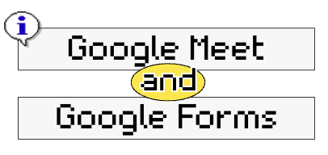
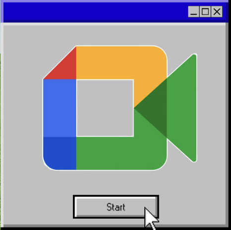
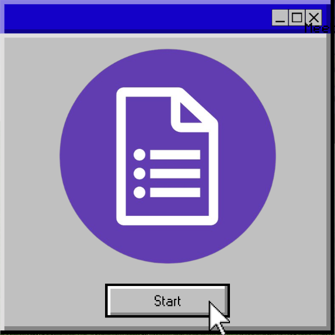
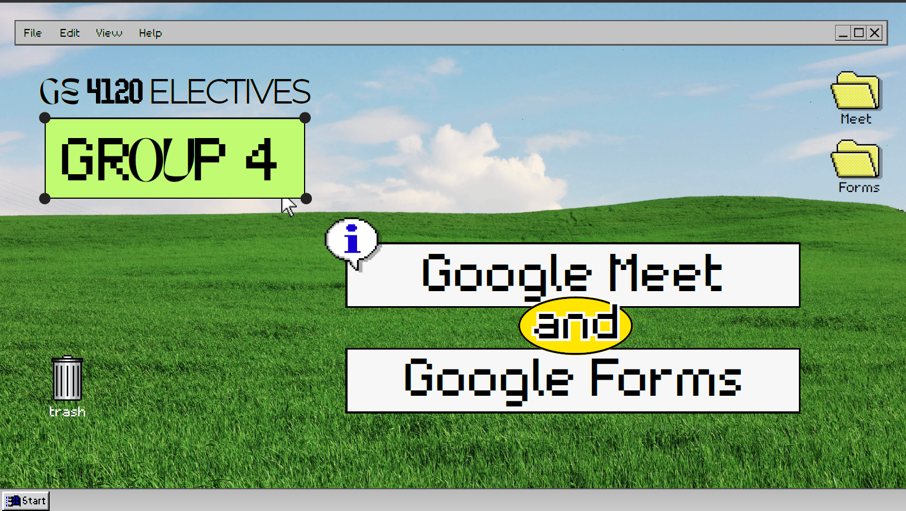

<b>✧･ﾟ MIDTERM REPORTING ･ﾟ✧</b>

<i>GOOGLE MEET AND GOOGLE FORMS</i>

 

  

  

 

Google Meet and Google Forms together bridge the gap between synchronous collaboration and systematic information management, making them essential tools for academic, organizational, and healthcare environments. While Google Meet provides a secure, interactive space for live discussions, lectures, and team check-ins through screen sharing, chat, and breakout rooms, Google Forms automates data collection by turning surveys, quizzes, and registrations into organized, real-time summaries and spreadsheets. Used in tandem, they create an efficient end-to-end workflow that allows facilitators to gather baseline information, host real-time collaborative sessions, and immediately evaluate feedback or assess comprehension without a manual administrative burden.

<table>
<tr>
<td width="20%" align="center">
  
</td>
<td width="80%">
  

  <b>Google Meet</b> serves as a virtual communication hub that replicates face-to-face interaction across distributed settings without geographical barriers. Features like screen sharing enable dynamic visual presentations and practical demonstrations, while live chat, hand-raising, and automated captions allow audiences to engage actively and inclusively without interrupting the speaker. Combined with host controls like breakout rooms and participant management, it provides a structured, accessible environment well-suited for academic lectures, team discussions, and professional collaborations.
  

</td>
</tr>
</table>

<table>
<tr>
<td width="20%" align="center">
  
</td>
<td width="80%">
  

  Meanwhile, <b>Google Forms</b> transforms manual information gathering into an automated, structured workflow. Creators can build custom surveys, quizzes, and registration forms with diverse question formats, input validation, and self-grading features. Responses are compiled instantly into visual charts and synced directly to a live Google Sheet, providing real-time data organization and analysis without administrative hassle.
  

</td>
</tr>
</table>

<i>Through this activity, we learned how to navigate both platforms, understand their essential functions, and apply their features through practical demonstrations and interactive quizzes. These tools demonstrate how technology can make communication more accessible, simplify information gathering, support learning assessment, and improve productivity in academic and professional settings.</i>

 

  

  <a href="GROUP-4-FORMS-AND-MEET-PPT.pdf">
    📄 View Google Meet & Forms PPT →
  </a>

<a href="Activity%204%20Outputs/GROUP-4-FORMS%20AND%20MEET%20PPT.pdf">
  📄 View Google Meet & Forms PPT →
</a>

 
 

<a href="https://docs.google.com/forms/d/e/1FAIpQLSfperDHgiW2recV86enfxMl6Lav0aZCxHtS3fycjsJGuVEPvw/viewform?usp=sharing&ouid=118413879498339873868">
  📝 View Google Forms Quiz →
</a>

 
 

<a href="Activity%204%20Outputs/GE-4120_G4_Quiz.pdf">
  📊 View Classmates' Quiz Scores →
</a>

 
 

 

  

 

  

<i> Working with Google Meet and Google Forms demonstrated how integrating synchronous communication with structured data management creates a resilient, efficient workflow. Google Meet showed me how virtual collaboration can transcend physical barriers through screen sharing and interactive discussion, fostering real-time teamwork and dynamic problem-solving.</i>

<i> Complementing this, Google Forms underscored the power of automated, standardized data collection, turning subjective feedback and assessment into immediate, visual summaries and actionable spreadsheets. Ultimately, using both platforms revealed that technological literacy is less about navigating interfaces and more about creating organized, accessible systems that streamline communication, minimize administrative friction, and support evidence-based decisions in academic and professional practice. </i>

 
